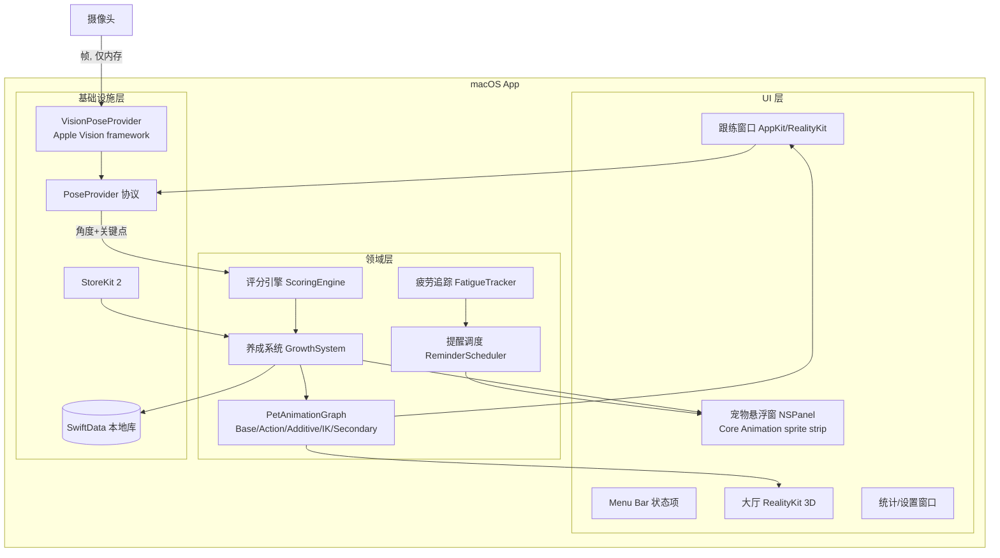

# 技术架构全貌

> 本文档描述产品当前的完整技术架构，代表最新全貌
> 随版本迭代持续更新，变更记录见 [changelog.md](./changelog.md)
> 技术决策记录（ADR）见 [decisions/](./decisions/)
> 产品架构见 [../product-arch/overview.md](../product-arch/overview.md)
> 研发工程文档见 [../../engineering/README.md](../../engineering/README.md)
> 最后更新：2026-10-12

---

## 架构概述

**纯端侧单机架构，V1 零后端。** macOS 原生应用使用 SwiftUI 与 AppKit，menu bar 常驻并以透明 `NSPanel` 承载桌面宠物；摄像头姿态识别使用系统内置 Apple Vision framework（100% 端侧，帧仅内存处理不落盘不上传）；大厅和跟练窗口按需使用 RealityKit 3D，桌面常驻宠物使用由同一 DCC 动作源烘焙的独立透明 sprite strip，以兼顾角色一致性和低功耗；数据由 SwiftData 本地存储，订阅走 StoreKit 2 本地验证。核心工程原则：姿态识别以 `PoseProvider` 协议抽象，角色动作以版本化 rig/clip manifest 隔离资产与运行时，为未来替换识别模型和扩展宠物动作预留稳定边界。

---

## 技术栈总览

| 层次 | 技术选型 | 版本 | 选型说明 |
|------|---------|------|---------|
| 客户端框架 | Swift + SwiftUI + AppKit | Swift 5.x / 最低 macOS 14 | SwiftUI 承载声明式界面，AppKit 承载窗口、输入和 RealityKit 生命周期 |
| 应用形态 | menu bar app（LSUIElement）+ NSPanel 透明无边框悬浮窗 | — | 桌面宠物常驻形态 |
| 姿态识别 | Apple Vision framework（主选）| 系统内置 | FaceObservation yaw/pitch/roll 直接对应转头/点头/歪头；VNDetectHumanBodyPoseRequest 肩部关键点；自动调度神经引擎，功耗最低；详见 ADR-001 |
| 姿态识别备选 | RTMPose/MoveNet 转 CoreML | Apache 2.0 | M1 bake-off 不达标时启用；V2 跨平台用 MediaPipe |
| 宠物 3D 渲染 | RealityKit | 系统内置 | 大厅和跟练窗口有界渲染；使用生产 Rig v2、采样 clip 和统一 `PetAnimationGraph` |
| 桌面宠物渲染 | Core Animation + 独立透明 sprite strip | 系统内置 | strip 与 3D 共用已批准 DCC 动作源，manifest 描述帧数/FPS/循环/事件；零第三方运行时，详见 ADR-002、ADR-003 |
| 角色资产 DCC | Blender | 4.3.2（生产版本锁定）| 离线重拓扑、手工蒙皮、控制 rig 和动作烘焙；静态拓扑由版本化机器合同治理，scoped WIP/diagnostic 不可晋级；主发布路径为原生 USD → USDZ → RealityKit，GLB 仅作交换/诊断产物 |
| DCC 隔离约束工具 | Python / NumPy / SciPy + OSQP / IPC Toolkit / Clarabel | 工程内按 wheel 指纹锁定 | 仅用于有界离线实验；OSQP / Clarabel 为 Apache-2.0、IPC Toolkit 为 MIT，NumPy/SciPy 主许可证为 BSD 系；不随 App 发布、不进入运行时，具体依赖及附带许可证见下文 |
| 数据库 | SwiftData（本地）| 系统内置 | V1 无账号无云同步 |
| 缓存 | 无 | — | 单机无需 |
| 消息队列 | 无 | — | 单机无需 |
| 对象存储 | 不使用 | — | V1 无文件上传需求 |
| 支付 | StoreKit 2 | 系统内置 | 订阅无需自建服务器 |
| CI/CD | Xcode Cloud 或 GitHub Actions（待定）| — | 送审自动化，M4 阶段定 |
| 崩溃/分析 | Apple 自带（App Store Connect）| — | V1 不引入三方 SDK，隐私叙事一致性 |

> 明确排除：YOLO 系（AGPL-3.0 闭源商用不可行）、OpenPose（非商用许可）、Electron/跨平台框架（悬浮窗/功耗短板）。

CHANGE-047 在 ADR-003 的离线实验边界内采用稀疏 QP 和连续碰撞库，不改变资产合同或 App 架构。
隔离环境中的 Jinja2 / MarkupSafe / joblib / cloudpickle 为 BSD 系，setuptools 为 MIT，coverage 为 Apache-2.0；
NumPy/SciPy wheel 另附数值库许可证，包括 GCC Runtime Library Exception，不能用一个 BSD 标签替代全部附带声明。
IPC Toolkit 的上游 CMake 依赖声明含 Eigen/libigl（MPL-2.0）、oneTBB/Abseil/Scalable-CCD（Apache-2.0）、
Tight-Inclusion/SimpleBVH/spdlog/robin-map（MIT）、pybind11（BSD）及可选 filib（LGPL-2.1）。
版本、Python 完整依赖锁、下载哈希、已安装许可证和上游构建配方归档到 App
`character_pipeline/sprout/v2/work/experiments/tripo-knee-constrained-solver-20260911/`。
预编译 wheel 的可选 C++ 构建开关不由包元数据完整证明，因此该环境只作本机离线工具，不把它作为可重新分发的依赖包。
本次没有新增基础设施服务，`local-env.md` 的纯本地模式保持适用。

CHANGE-048 另建隔离环境加入 Clarabel 0.11.1（Apache-2.0），用于同一凸子问题的独立内点法交叉验证。
新增 cffi 2.0.0（MIT）和 pycparser 2.23（BSD-3-Clause）；只读复用 C1 已锁定的 NumPy/SciPy/OSQP，
不改旧实验环境。新增 wheel 哈希、许可证及 Clarabel 的 Cargo.toml/Cargo.lock/pyproject.toml
由 App `tripo-knee-qp-diagnostic-20260911/` 证据绑定。Rust 可选构建依赖随配方保留，不以主许可证替代全部依赖声明；
该环境仅本机诊断，不随 App 分发。仍沿用 ADR-003 的离线职责，不变更运行时或基础设施。

CHANGE-076 为一次已结项的固定实体工具核查另建 Gmsh 4.15.2 本机环境（主许可证元数据 GPLv2+），同时安装 NumPy 2.4.3 与 SciPy 1.17.1；最终检查脚本仅需要前两者，SciPy 未使用。
官方 PyPI wheel、运行库和许可证/安装记录的指纹保存于 App `character_pipeline/sprout/v2/work/experiments/gmsh-fixed-entity-probe-20260920/`；第三方二进制与源码留在私有环境，不入仓或随 App 分发，也未在此认证整套二进制的重新分发许可。
单次小样发现 Algorithm 11＋MeshOnlyEmpty 改动固定点和原连接，该接入方式已淘汰，未成为生产 DCC 选型。沿用 ADR-003 的隔离实验职责，不引入新服务、存储或运行时依赖，无新 ADR；`local-env.md` 纯本地模式不变。

CHANGE-079 准备 CGAL 6.2.1 的本机离线输入桥接，官方 library 压缩包摘要绑定 CHANGE-078。三角化包头文件为 GPL-3.0-or-later 或商业许可；仅在私有目录提取并尝试编译，最终受 Xcode 许可拒绝阻塞，没有可运行桥接或网格调用，也未进入生产选型。
复用既有 GCC 13.2.0（本机配方声明 GPL-3.0-or-later with GCC-exception-3.1）、Boost 1.84.0（BSL-1.0）、GMP 6.3.0（LGPL-3.0-or-later 或 GPL-2.0-or-later）和 MPFR 4.2.1（LGPL-3.0-or-later）；安装收据、配方和现存许可文件指纹已登记，未安装新依赖，不由这些元数据推断整套产物可重新分发。
新 Python 输入检查器继续使用既有 NumPy 环境。只保留自有未执行桥接源码、检查器及有界证据；第三方源码/二进制不入仓或随 App 分发，临时展开头文件已移除，原始发行包保持。仍是 ADR-003 的隔离实验，无架构边界、基础设施或 App 运行时变更，无新 ADR。

CHANGE-111 为第一块的一次有界可行性求解，在新私有 vendor 目录安装 Clarabel 0.11.1（Apache-2.0）、cffi 2.0.0（MIT）、pycparser 3.0（BSD-3-Clause）三份锁定 wheel；只读复用已有 Python 3.14.5、NumPy 2.4.3、SciPy 1.17.1。
实际 wheel 哈希、已安装许可/元数据指纹及安装记录保存在 App `character_pipeline/sprout/v2/work/experiments/sprout-phase-one-feasibility-20261008/`。第三方 wheel、源码、二进制和 vendor 留在私有环境，不入仓或随 App 分发；不以主许可证标签替代可重新分发认证。
一次求解的数值与平面几何通过，但五质量门槛仅通过两项，结果未采用，不引入生产 DCC 选型或资产。仍沿用 ADR-003 的离线隔离职责，无 App 运行时、基础设施或配置变更，无新 ADR；`local-env.md` 纯本地模式不变。

CHANGE-116 已实施获批的髋表面frame与固定raw切向独立v3量测及 `hip_branch_diagnostic` API；正式CLI/S0仍使用旧v2，原骨枢轴、权重/动作与正式资源保持。592原quad域整体作者后，1初稿+2实际修订均失败；最终36折面、131自交对、76面AR超限，髋圈/条带、双groin及左实际保护一圈仍失败。内部双向有限P95改善至5.3257/5.2118mm和895锚点exact回放不构成物理关联/变形验收，不采用为生产候选；修订额度用尽，不再改mesh或自动新开模型轮。三小时含归档及双仓推送，无新运行时/基础设施/依赖或架构边界，不新建ADR。详见[版本源布局 §31](../../versions/v1.0.0/engineering/pet-character-source-layout.md)。

---

## 系统架构图

---

## 模块划分

| 服务/模块 | 职责 | 技术栈 | 对应工程仓库 |
|---------|------|--------|-----------|
| macos-app | 全部产品功能（单工程）| Swift/SwiftUI/AppKit + Vision + RealityKit + Core Animation + SwiftData + StoreKit 2 | [nickbody-macos](https://github.com/zt994451054/nickbody-macos) |
| 官网 | 落地页 + 隐私说明 + MAS 导流 | 静态站（待定，如 Astro）| 待创建 |

---

## 可观测性设计

| 维度 | 方案 | 说明 |
|------|------|------|
| 日志 | os.Logger 本地日志 | 不上传；敏感数据（摄像头相关）永不入日志 |
| 指标 | App Store Connect 自带分析 | 下载/订阅/崩溃 |
| 链路追踪 | 暂未引入 | 单机应用不适用 |
| 告警 | 暂未引入 | — |

---

## 部署架构

### 环境划分

| 环境 | 说明 | 部署方式 |
|------|------|---------|
| dev | 本地开发 | Xcode 本地运行 |
| staging | 内测/公测 | TestFlight |
| prod | 生产 | Mac App Store |

### 高可用设计

单机应用不适用。关键健壮性要求：摄像头被占用/缺失时自动降级纯跟练模式；悬浮窗常驻的内存/功耗预算（后台 CPU <1%，跟练中合理占用）。

---

## 安全架构

| 安全层面 | 方案 | 说明 |
|---------|------|------|
| 认证 | 无账号体系 | V1 单机 |
| 摄像头隐私 | 帧仅内存处理，不落盘、不上传、不入日志 | 产品第一卖点，架构级保证 |
| 权限申请 | 摄像头权限仅在用户同意跟练时请求 | 含用途说明文案 |
| 传输安全 | 无网络传输（除 StoreKit/官网）| — |
| 数据加密 | SwiftData 本地容器（系统沙盒保护）| 无敏感个人信息 |
| 数据合规 | GDPR/CCPA 天然合规（数据不出设备）| App Store 隐私标签如实申报 |
| 依赖安全 | 零第三方运行时依赖（全部使用系统框架）| 最小依赖面 |

---

## 关键技术决策索引

> 详细决策过程见 [decisions/](./decisions/) 目录下的 ADR 文件

| 决策编号 | 决策主题 | 状态 | 引入版本 |
|---------|---------|------|---------|
| [ADR-001](./decisions/ADR-001-pose-estimation.md) | 姿态识别选型：Apple Vision framework vs 开源模型 | 已接受 | v1.0.0 |
| [ADR-002](./decisions/ADR-002-sprite-animation-replace-rive.md) | 宠物动画渲染选型：原生精灵图集切帧替代 Rive Runtime | 已接受 | v1.0.0 |
| [ADR-003](./decisions/ADR-003-production-character-animation-pipeline.md) | 生产级角色动画资产管线与运行时分层 | 已接受，分阶段实施 | v1.0.0 |

---

## 性能基线

| 指标 | 当前值 | 测试条件 | 测试版本 |
|------|--------|---------|---------|
| 跟练时姿态推理帧率 | 待 M1 实测（目标 ≥15fps）| MacBook Air M1 基线机型 | v1.0.0 |
| 后台常驻 CPU 占用 | 待实测（目标 <1%）| 宠物闲时动画 | v1.0.0 |
| Vision 肩部关键点稳定性 | 待 M1 bake-off | 坐姿近距（0.5–1m）| v1.0.0 |
| Rig v2 变形质量 | 生产Rig尚未建立；CHANGE-116初稿+2修订均失败，最终贴合局部改善但几何/髋裆/左保护仍不合格；修订额度已用尽，正式S0/CLI仍v2 | 历史430样本及CHANGE-113基线保持；895固定锚点数值回放不认证物理关联或蒙皮，production Gate 0–4未过 | v1.0.0 |

---

## 说明

- 本文档代表技术架构当前全貌，不记录历史状态
- 每次版本迭代涉及架构调整时，同步更新本文档并在 changelog.md 追加记录
- 重大技术决策须在 decisions/ 目录下创建对应 ADR 文件
- AI 在做技术方案设计前，应先读取本文档了解技术架构基线
→ 变更记录见 [changelog.md](./changelog.md)

### CHANGE-117 最新角色诊断状态（2026-10-10）

已定位body/leg参数突变（约6cm）、裆桥端回折和接口残差三个独立作者错误。原最终36折面/131全对角自交索引完整重放；连续椭圆反事实0/0却因AR、裆部抬高、v3/保护失败而拒绝，不能称模型修好。 完成56条连续原三角guide与193段共同裆缝，固定21mm同侧环带因两slot27到X=0而缺站；零新Blend。七块源域/中央14×3计数和上腹五扇区整数算法已提出，完整索引、四环/双支撑及通过全部门槛的坐标表未完成；只作为有明确前置条件的施工设计。20输入+9 Blender几何控制通过，正式骨架、v2/S0、保护与资源保持。 本轮没有新增获批生产候选，旧失败和关闭方法保留。

[修复设计](../../versions/v1.0.0/engineering/pet-hip-embedding-repair-design.md)。

### CHANGE-118 最新角色施工状态（2026-10-10，进行中）

完整895/848连接及最新两份895行坐标CSV、统一原三角UV域已核验，168根部quad内部实际float32零折/交/T/退化，AR和不变固定切向/四环通过。八份完整点表均被拒绝；最新最佳/末态29折/6交/32坏AR及33折/5交/37坏AR，四环/支撑/保护通过仍有短边挤瘪。969/922细分连接仅组合原型，实际坐标和新增异常价保护尚未通过；零新Blend，生产角色继续阻塞。仅离线hip诊断，无架构边界、运行时依赖、正式合同或资源变更。[具体施工](../../versions/v1.0.0/engineering/pet-hip-shared-chart-construction.md)。

### CHANGE-119 历史角色施工状态（2026-10-11，未达完整验收）

**CHANGE-119 历史实际施工（原事实保留）**：同一raw root4原PL几何与78边界的度量Source78已实际通过全部有限源检查（left`362e46a2…`／right`5037243b…`／review`23bb9b2d…`）；左右6295/6194分析cell、6327/6226 atlas三角保持。每侧249V/457E/209Q的upper209目标盘与固定必要条件已实际二维通过（target`0e8b5241…`／fixed`c1a102a2…`／recipe`898af2df…`），非正cross、非邻接边contact和quad overlap均为0；这些通过不认证完整三维。唯一577作者（409上域+168literal根下域）与原969/922完整三维已实际执行（G0`e7e0be41…`／geometry`8ede39fc…`／v3`0324650f…`）；最新结果仍拒绝：54折面、100个all4交对、40坏AR/max15.00978865，完整14星保护8异常点失败（summary`c1b2e022…`）。168腿根Q与336保留面在各自范围均0折/0交/0坏AR，8环、168有向连接及双groin全部通过。392硬点（含56接口）的baseline native float32字节保持；旧168根及批准26点的原锚逐值、native float32字节保持，JSON double坐标并非全部逐值相同（根0/168、批准26点13/26）；336保留面sourceID和有序cycle保持（precision`3ada593f…`）。§4.16的两侧buffer21已在原PL有限区间重选：原26点中仅两点改变，12Q及两6星原native实际通过（points`cdb87012…`／native`18f13ceb…`），141/374只通过已定边必要界，完整外接Q仍待22点。早期相位Source V2的六组support解析完成，但固定外接AR共同预算的前/后区间空交（interval`2c79493c…`／cause`675092c4…`／necessary`b4d1deb7…`），零新84点/零native42。桥侧Source V1在13个已声明raw副本视图处拒绝；Source V2仅left22/23两条guide及两站完成，left24的既有非unit共边父视图未被消费而拒绝（actual`feb03dcd…`／cause`7a8d76ec…`），不是完整20通过。旧V3仅PREPARE、未实际执行；V3.1唯一实际已完成left22..26五条guide及22..25四站，left26原有限区间为空而拒绝（actual`7c4f593f…`）。真实路径在root4原域下界终止；face145固定47.1968mm边要求径向≥13.4848mm，而全部4片最多6.5333mm，原必要多项式全片严格负，与前四站greedy选择无关（cause`17af150f…`／独立终点`22636aee…`）。当前四翼26端部的原native12Q/两6星已实际通过（`faa027e0…`／`2ac104e6…`，maxAR3.3018111），647固定点域及536已知外接必要检查通过；新自然相位84原锚源与原native42Q/12处3/5星亦实际通过（source`2011837e…`／native`1fc4d314…`／closeout`28661437…`），84原锚forward亦实际通过（`c52a5e7d…`；`6cc01503…` bounded closure保全），均限局部，不授完整14星或外接922面。新全20同列sourcePL规则的唯一实际完成全部20条路径及190全路径交对、无非许可接触（recipe`426a67ae…`／actual`13df01b7…`，683输入前后exact）；首站left22在face141两AR必要域空交而拒绝：弧长须≥16.862508mm同时≤15.276447mm，63个PL片均被有限证书覆盖（`8c479323…`）。零已选站位、零Native28执行，used-prefix检查未执行；只否当前直UV导向，不证明源域或图无解。旧版本/失败/独审保持；完整20站与Native28均未通过。GUIDE-ONLY新84约束图唯一实际（`065c72ea…`）固定必要条件通过（每侧130固定角/28固定Q、固定边0接触），完整209却每侧6个坏Q/17对边接触，`guideGraphPassed`与provider均false；未采用失败导向图，零新source路径/站位/Native28执行。后继单一共同余量LP+unit Dirichlet QP实际亦被拒绝（`ad87013c…`／独审`ef4b53a2…`）：每侧9511线性行及131固定三角通过，但完整209每侧仍6坏Q/25边接触，15个非正三角均含2或3个自由角；右侧dual sign亦未通过。provider仍false，没有采用失败UV。已预登记完整836三角的两阶段耦合构造，26项纯控制通过（core`3462586a…`／controls`6db3bfb6…`／closeout`92846de4…`）；只执行合成盘，当前真实249角构造/新路径/站位/Native28均未执行。最新保全022（`4fb85b36…`）：6766旧文件0漂移，三仓HEAD/branch、App4725与用户4项状态保持，仅Panel9项在授权范围内。前轮`7852a22a…`／`4fb318a0…`的53折/95交/38坏AR/7保护星拒绝及`b91c4985…`原因定位证据保留。旧自然切缝的6个固定UV坏面已由intrinsic对应修正消除，但随后全84目标盘的15个UV坏面原失败保持；当前二维通过来自新的root4上部严格凸域。旧全目标88盘候选68折/74交/42坏AR、八环仅2过及76连接失败的原记录保持拒绝。零认证完整表、零新Blend、无保存许可；未重载originalBlend，故无G1实际认证，归档/生产/S0/rig仍阻塞；原骨轴、fit域、场和masks不变。

969/922真实过渡带与14异常价完整星正在施工；六组42Q有限小片通过。单次同态续算原全检86折面/10交对/97坏AR，八髋环/双groin/14星保护通过，43条有向nT仍失败。有限尺寸诊断确认数值余量有方向盲区，显式无量纲恢复已在902.115秒结束，无BEST或重启；原全检78折面/0交对/45坏AR，八环仅4过、37条连接失败，双groin/14完整星通过；完整预检仍拒绝。原二维变量、场/骨轴/保护/门槛、392点/56接口及336有向原面保持。完整坐标认证、形体与条件保存/真实重读尚未通过，零新Blend，生产角色继续阻塞。仅离线髋部诊断，无运行时依赖或架构边界变更。[本轮实际记录](../../versions/v1.0.0/engineering/pet-hip-transition-band-construction.md)。

### CHANGE-120 历史角色接续状态（2026-10-11，阻塞）

**CHANGE-120 当前接续结果（2026-10-11，阻塞）**：当前新切缝 Source78 左右度量 atlas 已实际完成，各侧原 mean-value 求解调用及返回均为1；本次完整父域、两fan与UV交对重新检查通过（left `a3b7bcce…`／right `f29caef8…`／source review `0b642b60…`），有限源独审 `221f0b7d…` 通过。forward v3 的100项控制、target v4 的13项控制、point v3 的49＋16项控制及各自 PURE 独审全部通过（`1567982e…`／`2b721827…`／`07cbf2aa…`）；历史资格别名准入、仅9个固定当前源身份的完整严格 EOF 读取和577 producer账本／直接seed分层已修正，原数学、作者、field、阈值与冻结条件保持。

**已消费的历史有限前置**：本轮实际源已消费2026-10-11 17:07（UTC+8）合格native28回执（`e8aa2255…`），45支持点／28Q的原native、finite与AR检查通过，折面／all4交对／T点／退化／重复均0，maxAR3.4961213125＜3.5；本轮未重跑。旧GUIDE-ONLY“零Native28／未通过”是当时早期尝试状态，后续这一有限28Q前置已通过；完整14星／全部cofaces／完整表／模型保存仍未获资格。

forward 配方冻结在原严格fallback读取历史 `bridge-transverse-path-preparation/actual-entry-controls-first-attempt.json`（`fbea292e…`）时拒绝，`BindingSyntaxError` 位于line8,column6：三项 `inputBindings` 记录含额外 `preservedSnapshot`，不符合exact `{path,sha256}`；旧script SHA亦不代表当前原path字节。只读诊断 `fca69ea7…` 保留完整见证。forward recipe未导出，当前26／104映射未执行；本次实际target、577作者、969／922整带全检、完整坐标表与模型保存均未执行，新增保存模型为0，角色生产／S0／rig仍阻塞。该失败属于历史收据的依赖账本准入，不能解释为几何无解。

下一步在新的独占版本迁移该历史失败收据的依赖账本并重资格：明确历史原path、对应保全snapshot与各自完整SHA，执行依赖角色仅使用真实exact path／SHA身份；原收据、旧文件与严格解析规则保留。新迁移及控制、独审通过后再从forward冻结接续，随后仍依次核实际映射、target、577和整带门禁。归档与双仓推送的实际状态统一见 CHANGE-120；下列 CHANGE-119 记录保持历史事实，不继承为本次几何资格。

仅离线施工及metadata IO准入修订，未改变App运行时、基础设施、正式资源或架构边界；无需新增ADR。

### CHANGE-121 历史角色接续状态（2026-10-12）

当前可达依赖账本迁移及重独审通过，136行forward实际回放通过；Source78直接复用、零新source求解。唯一target入口在原固定必要几何拒绝：left face147／right face381及3／10固定边接触，完整solver尚未调用。577、969/922整带、完整表与保存未执行，新增模型0；生产／S0／rig仍阻塞。新common与transitive owner资格、完整当前身份和旧失败保全见[施工记录§7](../../versions/v1.0.0/engineering/pet-hip-transition-band-construction.md#7-change-121可达账本迁移与原完整整带接续)。本轮没有App运行时、基础设施、数据所有权或架构边界变化，无需新ADR。

### CHANGE-122 当前角色修订状态（2026-10-12）

固定UV有界修订后的cut、source分区、atlas及136角forward实际与独审已通过；左右140固定角／39完全固定Q／全部固定边保持。历史原core每侧调用／返回2，历史CHANGE-123 r2每侧current调用／返回1、PII各0的失败证据完整保留。CHANGE-124数学双独审、Target/v6十源封存／111项PURE／非作者PQA与fresh ENTRY及ROOT完整字节复验通过；唯一新actual左右每侧current调用／返回1，fresh原seed／PI／PII各1，原PI／PII／strict disk及当前施工门全部通过，无重试、source查询或模型。SavedTargetQA/v4完整51项PURE、非作者47tiny／fresh51＋10真实CLI及ROOT43,432角色准入全部通过；唯一真实保存复算def14b1e及ROOT193,594角色完整后验通过，左右原全部几何／PI／PII和当前施工门重算通过，无新求解／source查询。Point/v4九源封存、66项完整PURE与非作者PQA通过，fresh ENTRY独审及ROOT82,459角色／342,412 owner字段完整准入通过，唯一实际在原field辅助文件导入PIL时失败037a3cda，作者调用／返回0、field构造部分进入未返回，原失败／输入字节保全；Point/v5十一源880c0019已封存、101项完整PUREa2d91618通过，ROOT33,021角色完整作者后验5637df83通过，非作者首次正式PQA在NumPy memmap类定义处被过宽profile拒绝，封存失败保留；新五源观察器v2 c09b8560封存、48项fresh控制通过，失败后32,993角色完整字节保全ba801027通过，新正式PQA9432c02c通过101＋48＋45／28控制、33,017完整角色／8,678路径及Pillow定义边界复验，ROOT66,051角色完整后验342ea438及生产准入通过，新14份配置972d1be0齐，唯一metadata配方冻结331ffad2／b70e231d通过，真实ENTRYde0e2dc9／唯一进程b09c9573严格通过，ROOT347,627角色／8,715路径／343,200 owner字段完整入口后验6e690862通过；新ROOT实际外层v4 c854e7d6的24纯证据控制及非作者静审38ce6776通过，唯一guarded CLI已启动、作者返回和实际结果仍待真证据；SavedPointQA/v3七源已封存、34项完整PURE通过，非作者33项与完整静态审核通过，正式readiness5c952b5e失败：fresh34为33通过／1被原module guard拒绝，原证据保全；新独占profile capsule-v2准备通过；SavedPointQA/v4七源68e10378正式封存、52项完整PURE7e7fe835通过，66,026角色／8,705路径完整字节一致，ROOT66,037角色完整作者后验cafed72d通过；新非作者九源观察器10c82279封存，完整66,431角色／8,782路径静态审查与fresh39通过，ROOT132,876角色完整独审静态后验eb1b0f2a通过；新正式readiness外层v3三源29b40bb9封存、18完整纯控及ROOT310角色完整支持后验8b6958a7通过；ROOT真实QA外层v9 fb38d827和32项纯证据控制通过、独立静审3ccbb892无已知阻挡；真ENTRY及ROOT入口后验已齐，唯一正式readiness失败444ffe13／d1bd0c2e：capsule runtime公开2字段与完整3字段不等，suite启动0、52／39／3CLI均未运行，bdd172dc限定因果核真；新observer-v2边界补完整runtime元数据，原作者与capsule guard不改，不授实际QA资格。Whole/v3九源封存、50项完整definition-only PURE通过，独审v1拒绝保留；v2独审P1/P2=0、fresh50＋12 tiny及ROOT完整93,099角色／生产准入复验通过；Point14份真实upstream已齐，真实141,224,671字节recipe冻结通过，fresh ENTRY811fce77及原进程77ec9082通过，Whole/v4最终12源a8daea88封存后的唯一完整77 PURE失败9d82a612：62实际60通过／2旧mock缺Point5家族字段ERROR，15容量未派发，152,679角色／21,158路径完整前后保持；限定因果观察a4db7c12通过，历史失败与sealed源保留，新exclusive Whole/v5仅补两mock三字段及边界文字后独审／重封／fresh77，四项未来实际资格仍未晋升。保存前Post-G0/v1容量拒绝完整保留；v2十一源封存、83完整PURE与ROOT178,735角色完整复核通过，独立59项本地控制及真实账本重建通过；当前真实账本容量上界832,813,416字节低于原1GiB，原namespace／长度／字节／23-20-167数学均保持，非作者fresh83＋fresh59＋6生产负控PQA严格0及ROOT178,948角色完整后验／生产准入通过，仅四个presave动作准备；后续六动作保存层十一源c5464c33封存、106项完整PURE072fe463通过，ROOT178,750角色完整复核d469b5c5通过，六源observer3ded94dc封存、64本地控制及真实账本预检通过，fresh106＋64＋6生产负控PQA2c74153a通过、ROOT178,970角色完整后验7682b6c7及生产准入通过，不授实际资格。原577实际点尚未生成，首次失败未进入作者；969-922整带／完整表／条件保存与重读尚未执行，新增模型0；生产／S0／rig仍阻塞。 详见[施工记录§8](../../versions/v1.0.0/engineering/pet-hip-transition-band-construction.md#8-change-122固定uv有界修订与实际完整target诊断)及[CHANGE-122](../../versions/v1.0.0/CHANGES.md)。无框架、基础设施、存储或正式资源变更，原生产架构保持。
